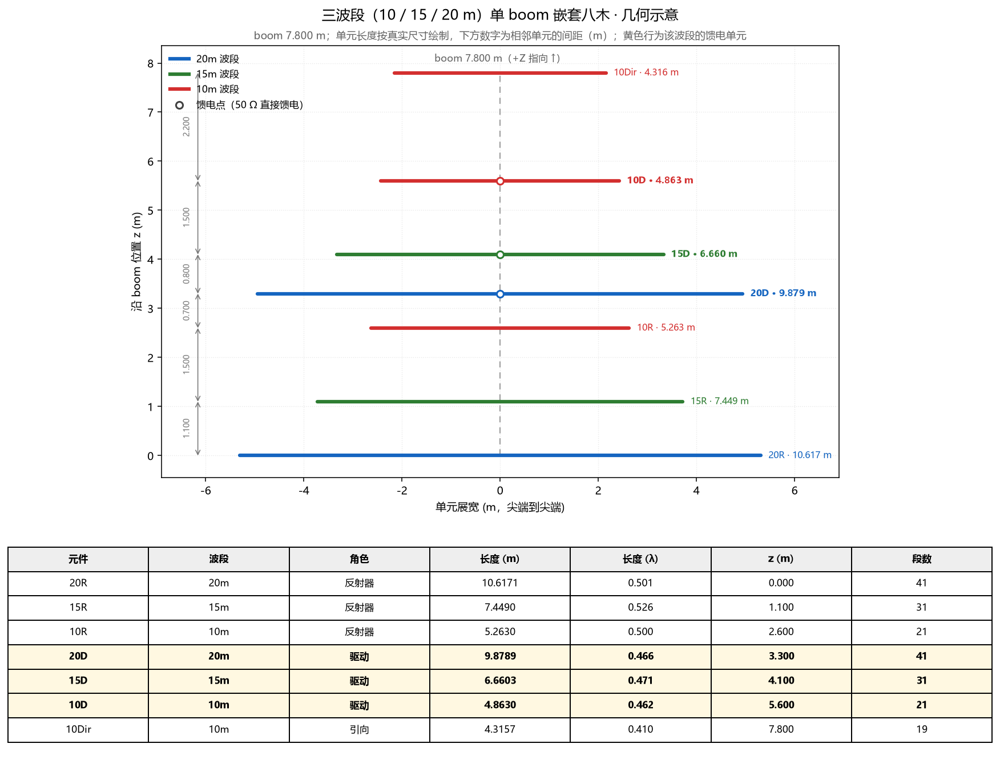
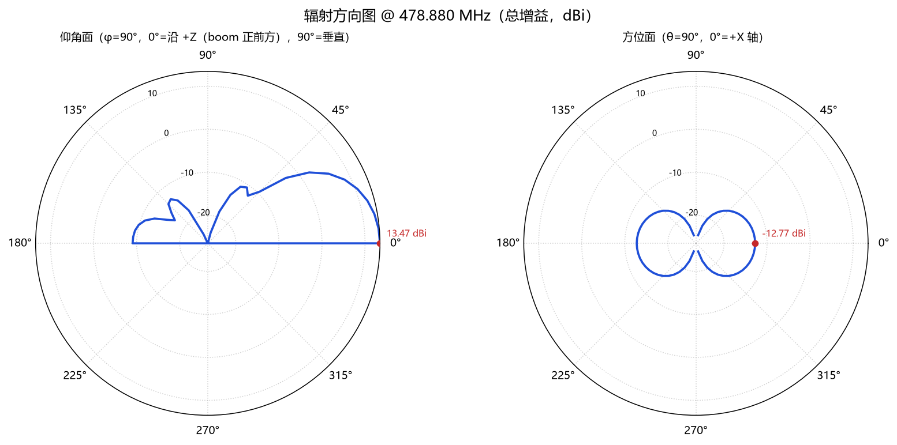
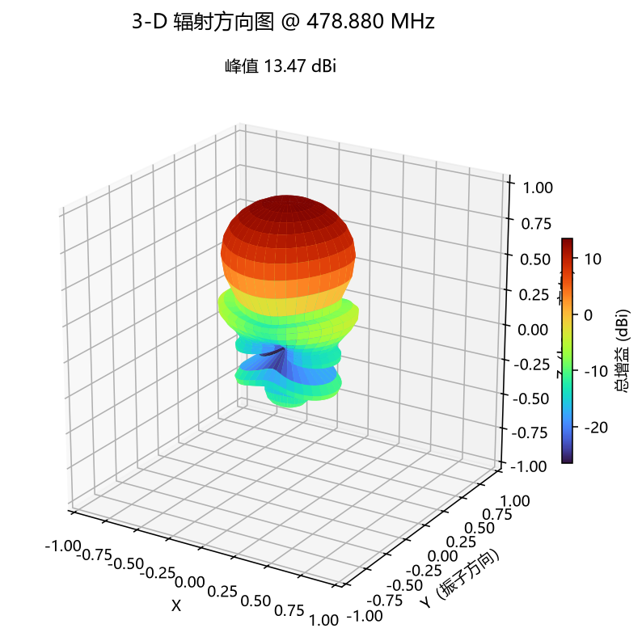
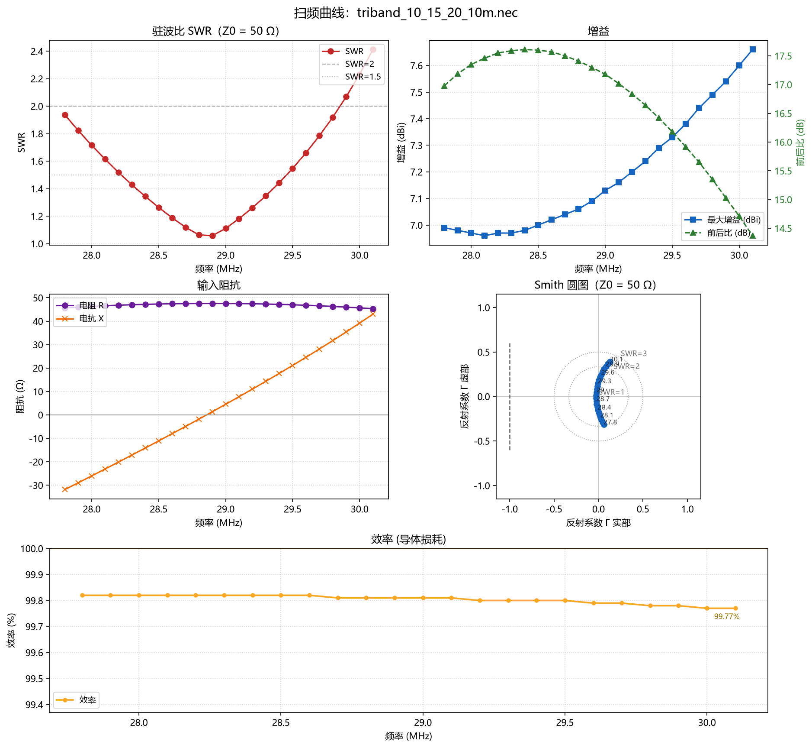

# 4NEC2 MCP Server

把 [4NEC2](https://www.qsl.net/4nec2/) 自带的 NEC-2 引擎包装成 [MCP](https://modelcontextprotocol.io/) server，
让 DeepSeek Harness（DSH）或任意 MCP 客户端用自然语言驱动天线建模与仿真：
建 Yagi 模型、算阻抗/SWR/增益/前后比、扫频、读 `.out` 文件、按目标做几何优化。

- 传输方式：`stdio`（DSH 等客户端拉起的默认方式）与 `streamable-http`
- 11 个工具，全部返回 JSON（错误统一为 `{"status": "error", "error": "..."}`）
- 除数值结果外还能直接出图：极坐标方向图、3-D 波瓣、SWR/增益/阻抗/Smith 圆图扫频面板（PNG）
- 引擎是交互式 exe，server 内部已用临时目录 + `input.inp / output.out` 正确驱动，并屏蔽黑窗
- 不修改 4NEC2 的安装文件；`--4nec2-dir` 可指向任意 4NEC2 安装目录
- 设计新天线前请先和用户确认需求（馈电拓扑、振子直径、尺寸约束等）：[docs/设计需求清单.md](docs/设计需求清单.md)；
  并优先查 [docs/模型目录.md](docs/模型目录.md)（G0KSC 参考库 372 个 + 4NEC2 示例 20 个，自动生成），有接近的模型就直接采用

## 🏆 成果展示：[10 / 15 / 20 m 三波段单 boom 八木](docs/showcase-triband.md)

用本项目的工具从零设计并优化出来的一套**三波段嵌套八木**（10 m 3 单元、15/20 m 各 2 单元，每个波段独立 50 Ω 馈电 + 天线开关；三个激励振子并联到同一巴伦的拓扑实测失配，见 [§3](designs/triband_10_15_20/README.md)）：
带内 SWR ≤ 1.8、增益 5.7–7.0 dBi、效率 99.7 %，附带几何图、驻波/效率曲线、方向图与架高对比。



| 波段 | 中心 SWR | 增益 | 前后比 | 效率 |
| --- | --- | --- | --- | --- |
| 10 m | 1.256 | 7.00 dBi | 17.6 dB | 99.82 % |
| 15 m | 1.192 | 5.74 dBi | 11.9 dB | 99.75 % |
| 20 m | 1.042 | 6.29 dBi | 11.3 dB | 99.69 % |

→ 完整成果页 [docs/showcase-triband.md](docs/showcase-triband.md) ·
工程细节 [designs/triband_10_15_20](designs/triband_10_15_20/README.md)

### 🆕 同一套工具的第二种馈电拓扑：三个激励振子并联到一个巴伦

上面那套是「三路独立馈电 + 天线开关」。如果想按常见的「三个驱动单元直接并联、单巴伦 50 Ω」来做，
本项目也把这种拓扑建了模（`Design.parallel_deck()`）并按该拓扑重新调优过，**三个波段全段 SWR < 1.9**：

| 波段 | SWR 范围 | 中心增益 | 前后比 |
| --- | --- | --- | --- |
| 10 m（28.0–29.7） | 1.35–1.89 | 7.86 dBi | 10.5–12.0 dB |
| 15 m（21.0–21.45） | 1.54–1.89 | 5.62 dBi | 2.2–5.6 dB |
| 20 m（14.0–14.35） | 1.47–1.87 | 7.44 dBi | 6.1–8.2 dB |

尺寸表、母线做法（两条母线 + 6 根连线 + 单点 `EX`）、复算与复现命令：
[designs/parallel_reference](designs/parallel_reference/README.md)。

---

## 典型输出（`nec_plot_pattern` / `nec_plot_sweep` 直接返回 PNG 路径）

| 极坐标方向图 + 3-D 波瓣（8 元 Yagi @ 478.875 MHz） | |
| --- | --- |
|  |  |



---

## 1. 环境要求

| 项目 | 要求 | 本机实测 |
| --- | --- | --- |
| 操作系统 | Windows（引擎为 Win32 exe） | Windows 10/11 |
| 4NEC2 | 已安装，含 `exe\nec2d*.exe` | `C:\4nec2`，引擎 `C:\4nec2\exe\nec2dxs11k.exe` |
| Python | 3.10+ | 3.13.13（项目 venv） |
| 依赖 | `mcp>=1.28,<2`，绘图另需 `matplotlib>=3.8`（见 [requirements.txt](requirements.txt)） | mcp 1.28.1 + matplotlib 3.11.2 |
| PowerShell | Windows PowerShell 5.1 即可（无需 pwsh 7） | 5.1.26100 |

4NEC2 不在默认目录时，用 `NEC4NEC_DIR` 环境变量或 `--4nec2-dir` 指定，例如 `D:\4nec2`。
引擎也可用 `NEC2_ENGINE` 指定具体 exe。

## 2. 目录结构

```text
C:\4nec2-mcp-server
├─ mcp_4nec2_server.py       # MCP server 入口（FastMCP，11 个工具 + CLI 参数）
├─ nec2core\                 # 与 MCP 无关的核心库，可单独 import 使用
│  ├─ engine.py              #   发现引擎、校验/清洗 deck、以临时目录驱动引擎
│  ├─ model.py               #   .nec 卡片解析、SY 符号求值、改频
│  ├─ output.py              #   .out 解析（FREQUENCY 分块、阻抗、方向图、功率）
│  ├─ metrics.py             #   SWR/回波损耗/增益/前后比/切面统计
│  ├─ yagi.py                #   YagiDesign → NEC deck 生成
│  ├─ plots.py               #   matplotlib 出图：极坐标/3-D 方向图、扫频面板
│  └─ optimize.py            #   坐标下降优化（SY 符号或 element_length 等变量）
├─ scripts\
│  ├─ install.ps1            # 一键安装：venv + 依赖 + 启动器 + 打印 DSH 条目
│  ├─ start-stdio.bat        # 用绝对路径拉起 stdio 版（install.ps1 生成）
│  ├─ start-http.bat         # 用绝对路径拉起 HTTP 版（install.ps1 生成）
│  ├─ check-tools.py         # MCP 握手自检：列出/调用工具
│  ├─ design_triband.py      # 三波段八木：生成/评估/优化 NEC deck + 几何图
│  ├─ ground_study.py        # 自由空间 vs 真实地面（5/8/10 m）仰角方向图对比
│  └─ check-links.py         # 检查所有 Markdown 相对链接/图片是否存在
├─ docs\
│  ├─ DSH-接入说明.md         # 接入 DeepSeek Harness 的完整步骤
│  ├─ 设计需求清单.md         # 设计天线前必须先向用户确认的需求 checklist
│  ├─ showcase-triband.md    # 成果展示：三波段八木（指标 + 全部图）
│  └─ images\                # README / 展示页引用的示例图
├─ dsh\cordis.mcp-nec2.yml   # 可直接插入的 DSH 配置条目（参考副本）
├─ designs\                  # 示例天线工程（含 NEC deck、几何图、仿真结果）
│  ├─ triband_10_15_20\      # 三路独立馈电 + 开关的三波段八木
│  └─ parallel_reference\    # 三驱动并联到单巴伦的三波段八木
├─ tests\                    # pytest 用例与夹具（.nec / .out）
├─ plots\                    # nec_plot_* 默认输出目录（生成物，已 gitignore）
├─ pytest.ini                # engine / server 集成测试标记
├─ requirements.txt
└─ .gitignore
```

## 3. 快速开始

### 3.1 一键安装（推荐）

```powershell
cd C:\4nec2-mcp-server
powershell -NoProfile -ExecutionPolicy Bypass -File scripts\install.ps1
```

脚本会依次：检查项目与 4NEC2 → 复用/创建 `.venv` → `pip install -r requirements.txt` →
`python mcp_4nec2_server.py --version` 冒烟 → 生成 `scripts\start-stdio.bat` 与 `scripts\start-http.bat`（绝对路径）
→ 打印 DSH 配置条目。

**默认只打印 DSH 条目，不改任何 DSH 配置。** 确认要写入时：

```powershell
powershell -NoProfile -ExecutionPolicy Bypass -File scripts\install.ps1 -ApplyDsh
```

`-ApplyDsh` 会：备份为 `cordis.patch.yml.bak-yyyyMMdd-HHmmss` → 幂等检查（已存在 `id: mcp-nec2` /
`mcp-4nec2` 或 `serverName: nec2` 则跳过）→ 以 UTF-8 无 BOM、沿用原文件换行风格追加条目。

常用参数：

| 参数 | 作用 |
| --- | --- |
| `-Nec2Dir D:\4nec2` | 指定 4NEC2 目录（默认 `NEC4NEC_DIR` 或 `C:\4nec2`） |
| `-ProjectDir <dir>` | 项目根目录（默认取 `install.ps1` 的上级目录，即脚本所在仓库） |
| `-ProfileDir <dir>` | 指定 DSH 配置目录（默认 `%USERPROFILE%\.dsh\profiles\desktop`） |
| `-PythonExe <path>` | 指定用于建 venv 的基础 Python |
| `-HttpHost` / `-HttpPort` | 写入 `start-http.bat` 的监听地址/端口（默认 127.0.0.1 / 8765） |
| `-SkipPip` / `-SkipEngineCheck` | 跳过装依赖 / 跳过引擎存在性检查 |
| `-Force` | 旧 venv 改名 `.venv.bak-<时间戳>` 后重建（不删除） |
| `-DryRun` | 只检查与打印，不做任何写操作 |
| `-ApplyDsh` | 真正写入 `cordis.patch.yml` |
| `-NoDsh` | 完全不涉及 DSH 配置 |
| `-Utf8Console` | 控制台中文乱码时尝试切 UTF-8 输出 |

### 3.2 手动安装

```powershell
cd C:\4nec2-mcp-server
python -m venv .venv
.\.venv\Scripts\python.exe -m pip install -r requirements.txt
.\.venv\Scripts\python.exe mcp_4nec2_server.py --version    # 期望输出: 2.1.0
```

### 3.3 自检（不经过 DSH）

```powershell
# 启动 server、握手、列出 11 个工具
.\.venv\Scripts\python.exe scripts\check-tools.py

# 顺便调用一个工具（--arg 每个参数写一项，PowerShell 5.1 下最稳）
.\.venv\Scripts\python.exe scripts\check-tools.py --call nec_list_engines
.\.venv\Scripts\python.exe scripts\check-tools.py --call nec_run --arg path=478MHz_8El_Yagi.nec --arg freq_mhz=478.875

# 在清单之后追加 serverInfo 与全部工具的 JSON schema
.\.venv\Scripts\python.exe scripts\check-tools.py --json
```

`check-tools.py` 支持 `--nec2-dir <dir>`（默认 `C:\4nec2`）；工具返回 `isError` 时脚本以退出码 1 结束。
参数也可以用 `--args '<JSON>'` 一次性传入，但 **Windows PowerShell 5.1 会在传给原生 exe 前吃掉 JSON 里的双引号**，
所以要给 `--args` 时请用 pwsh 7，或改用可重复的 `--arg name=value`（值能按 JSON 解析就按 JSON，否则当字符串）。
输出里夹带的 `Processing request of type ListToolsRequest` 是 MCP server 写到 stderr 的日志，
在 PowerShell 中会显示成红色 `NativeCommandError`，属正常现象，不影响结论。

### 3.4 接入 DSH（三步）

1. **备份**：`Copy-Item $env:USERPROFILE\.dsh\profiles\desktop\cordis.patch.yml "$env:USERPROFILE\.dsh\profiles\desktop\cordis.patch.yml.bak-manual"`（`install.ps1 -ApplyDsh` 会自动备份）。
2. **追加条目**：把 [dsh/cordis.mcp-nec2.yml](dsh/cordis.mcp-nec2.yml) 里的 `- insert:` 块粘到该文件末尾，
   或直接运行 `scripts\install.ps1 -ApplyDsh` 让它完成追加（幂等，已有条目会跳过）。
3. **生效**：保存后 DSH 会**原地重载**该 MCP 连接，新对话里即可看到 `mcp__nec2__*` 工具；没出现就重启 DSH。

之后在 DSH 里可以直接说（自然语言）：

```text
用 mcp__nec2__nec_run 跑 C:\4nec2\models\478MHz_8El_Yagi.nec 的 478.875 MHz，告诉我阻抗、SWR 和增益
```

或要求它做更复杂的操作：

```text
列出可用引擎，然后用 nec_sweep 扫 470–486 MHz、步进 4，再用 nec_build_yagi 生成 478.9 MHz 的 8 元 Yagi
（默认参数），最后对比前后比
```

要看图就直接说（工具会把 PNG 路径返回，DSH 会把图贴在对话里）：

```text
用 nec_plot_pattern 画 478MHz_8El_Yagi.nec 在 478.875 MHz 的方向图，带 3-D 波瓣
用 nec_plot_sweep 扫 468–492 MHz、步进 1，看看 SWR 和阻抗怎么变
```

完整步骤、字段含义与回滚方式见 [docs/DSH-接入说明.md](docs/DSH-接入说明.md)。

## 4. 命令行用法

```text
python mcp_4nec2_server.py [--4nec2-dir DIR] [--transport {stdio,streamable-http}]
                           [--host HOST] [--port PORT] [--version]
```

| 参数 | 默认 | 说明 |
| --- | --- | --- |
| `--4nec2-dir` | `NEC4NEC_DIR` 或 `C:\4nec2` | 4NEC2 安装目录（其下有 `exe\`、`models\`） |
| `--transport` | `stdio` | `stdio` 供 DSH/MCP 客户端拉起；`streamable-http` 提供 HTTP 端点 |
| `--host` / `--port` | `127.0.0.1` / `8765` | 仅 HTTP 传输有效 |
| `--version` | — | 打印 `2.1.0` 后退出 |

HTTP 模式：

```powershell
.\.venv\Scripts\python.exe mcp_4nec2_server.py --transport streamable-http --host 127.0.0.1 --port 8765
```

端点固定为 `http://127.0.0.1:8765/mcp`（FastMCP 默认路径 `/mcp`）。客户端示例（已实测）：

```python
import asyncio
from mcp import ClientSession
from mcp.client.streamable_http import streamablehttp_client

async def main():
    async with streamablehttp_client("http://127.0.0.1:8765/mcp") as (r, w, _):
        async with ClientSession(r, w) as s:
            await s.initialize()
            print([t.name for t in (await s.list_tools()).tools])

asyncio.run(main())
```

`scripts\start-http.bat` 是可双击/计划任务使用的启动器（绝对路径，`MCP_HTTP_HOST` / `MCP_HTTP_PORT` 可覆盖）。

## 5. 工具参考

所有工具都是同步返回 `dict`；角度单位是度，增益单位 dBi，阻抗单位 Ω，SWR 以 `z0`（默认 50 Ω）为基准。
`path` 可以是绝对路径，也可以是相对 `C:\4nec2\models` 的文件名。

| 工具 | 用途 | 是否跑引擎 |
| --- | --- | --- |
| `nec_list_engines` | 列出 4NEC2 下可用引擎及首选 | 否 |
| `nec_list_models` | 列出 `.nec` 模型文件 | 否 |
| `nec_describe` | 解析模型：频率、地网、导线、单元、激励、方向图卡 | 否 |
| `nec_run` | 跑单个 deck，返回阻抗/SWR/增益/前后比 | 是 |
| `nec_sweep` | 扫频（均匀扫频优先单次多频运行） | 是 |
| `nec_parse_out` | 解析已有 `.out` 文件 | 否 |
| `nec_build_yagi` | 生成 Yagi 模型并（可选）立即仿真 | 可选 |
| `nec_optimize` | 按目标做几何优化（坐标下降） | 是（多次） |
| `nec_plot_pattern` | 出极坐标切面图与（可选）3-D 波瓣 PNG | 是 |
| `nec_plot_sweep` | 出 SWR/增益/阻抗/Smith 四联扫频面板 PNG | 是（多次） |
| `nec_open_gui` | 在 4NEC2 GUI 中打开模型（缺 CE / 超 80 列的 deck 自动写 `*_gui.nec` 修复副本），按 F7 手动运行 | 否 |

### 5.1 `nec_list_engines()`

无参数。返回 `status`、`nec4nec_dir`、`preferred`（首选 exe 路径）、
`engines[]`（`path` / `name` / `folder` / `size_bytes` / `preferred`）。
本机实测首选 `C:\4nec2\exe\nec2dxs11k.exe`。

**四族引擎实测对比**（`C:\4nec2\NEC引擎\`，均为 NEC-2 双精度、同一协议、结果逐位一致）：

| 族 | 来源 | 1010 段 | 3000 段 | 说明 |
| --- | --- | --- | --- | --- |
| **NEC2/MP 多线程**（2012，4.8 MB） | NEC2/MP v1.50 | **0.20 s** | **1.4 s** | 矩阵填充/求解多线程，最快 |
| NEC2LP64（2023，21.6 MB） | jelanier@chemroc.com | 0.35 s | 3.4 s | 64 位 + LAPACK，官方称 FACTOR 快 6× |
| NEC2LP32（2020，13.9 MB） | 同上 | 0.53 s | 6.1 s | 32 位 + LAPACK |
| 原版 NEC2DXS（2009，335 KB） | 4NEC2 自带 Build 2.7 | 0.97 s | 21.0 s | 单线程基准 |

`exe\nec2dxs11k.exe` 经 MD5 核对**就是 NEC2/MP 多线程版**，所以默认首选已是最快引擎；
LP64 是最佳备选（64 位地址空间、LAPACK 数值库）。后缀 500/1k5/3k0/5k0/8k0/11k 是最大段数上限；
`exe\nec2d*.exe` 是老引擎，不接受 stdin 两行文件名协议，不能独立使用（需配合 Somnec2d.exe 处理地面）。

### 5.2 `nec_list_models(directory=None, pattern="*.nec", limit=200)`

`directory` 缺省先扫 `C:\4nec2\models`，再扫 `C:\4nec2\necfile`。返回 `status`、`count`、
`files[]`（`path` / `name` / `size_bytes` / `modified`）。

### 5.3 `nec_describe(path, include_cards=False)`

返回 `status`、`path`、`comment`、`frequency_mhz[]`、`ground`、`excitation[]`、`wires[]`、`elements[]`、
`total_segments`、`bounding_box`、`radiation_patterns`、`symbols`、`symbol_count`、`errors`、`warnings`；
`include_cards=True` 时附带解析后的卡片列表。

示例（本机模型）：

```powershell
.\.venv\Scripts\python.exe scripts\check-tools.py --call nec_describe --arg path=478MHz_8El_Yagi.nec
```

实测：`478.875 MHz`、8 个单元、`GN -1`（自由空间）、电压源激励在 tag 2。

### 5.4 `nec_run(path=None, deck=None, freq_mhz=None, engine=None, z0=50.0, timeout_s=120.0, save_out_path=None, include_pattern=False)`

`path` 与 `deck` 二选一；`freq_mhz` 会先改写模型的 `FR` 卡；`save_out_path` 保留原始 NEC 输出（否则用临时文件）；
`include_pattern=True` 时返回每个方向图采样点 `pattern[]`（`theta_deg` / `phi_deg` / `total_db`）。

返回字段：`status`、`engine`、`duration_s`、`segments`、`source`、`freq_mhz`、`z_real`、`z_imag`、
`z_magnitude`、`swr`、`return_loss_db`、`feed_impedance_ohm`、`gain_max_db`、`gain_max_theta_deg`、
`gain_max_phi_deg`、`front_gain_db`、`rear_gain_db`、`fb_db`、`polarization`、`efficiency_percent`、
`input_power_w`、`radiated_power_w`、`cuts[]`（`kind` / `fixed_deg` / `peak_gain_db` / `peak_angle_deg` /
`samples` / `rear_gain_db` / `fb_db`），以及 `model`、`frequency_override_mhz`、`engine_warnings`。

实测（`C:\4nec2\models\478MHz_8El_Yagi.nec`，478.875 MHz，50 Ω）：

```json
{
  "freq_mhz": 478.88, "z_real": 17.227, "z_imag": -19.203, "z_magnitude": 25.798,
  "swr": 3.379, "return_loss_db": 5.3, "gain_max_db": 13.47,
  "gain_max_theta_deg": 0.0, "gain_max_phi_deg": 90.0,
  "front_gain_db": 13.47, "rear_gain_db": -9.13, "fb_db": 22.53,
  "polarization": "vertical", "efficiency_percent": 100.0,
  "engine": "nec2dxs11k.exe", "duration_s": 0.086, "status": "ok"
}
```

一个 8 元 Yagi 峰值在仰角 0°（φ=90°）——这正是它该有的样子：方位面（θ=90°）切面峰值只有 -12.77 dBi，
因为主瓣朝天线轴向而不是水平面。

### 5.5 `nec_sweep(path=None, deck=None, start_mhz=None, stop_mhz=None, step_mhz=1.0, freqs_mhz=None, engine=None, z0=50.0, timeout_s=180.0)`

`freqs_mhz` 优先于 `start/stop/step`。**等间距**频点会走"一次多频运行"路径；间距不均匀时对每个频点单独跑引擎。

返回 `status`、`model`、`points`、`requested_points`、`rows[]`（每条 `status` / `freq_mhz` / `z_real` / `z_imag` /
`swr` / `gain_max_db` / `fb_db` / `efficiency_percent`）、`best_swr`、`best_gain`、`bandwidth_swr2_mhz`
（没有 SWR≤2 的点时为 `null`）。

> **实现细节**：4NEC2 在"一次多频运行"里只为最后一个频点打印第二张方向图（仰角切面），其余频点只有方位切面。
> 因此服务端先检查每个频点块的方向图是否完整，不完整就自动回退为逐频点运行——增益始终按全部方向图样本取峰，
> 等间距扫频与逐点 `nec_run` 的结果一致（代价是耗时约为一次多频运行的 N 倍，N 为频点数）。

实测（等间距 470–486 MHz，步进 4；阻抗/SWR 已与逐点 `nec_run` 核对一致）：

```json
{"status":"ok","points":5,"requested_points":5,
 "rows":[{"freq_mhz":470.0,"z_real":15.466,"z_imag":-32.541,"swr":4.699,"gain_max_db":12.92,"fb_db":17.47,"efficiency_percent":100.0},
         {"freq_mhz":474.0,"swr":4.2,"gain_max_db":13.2,"fb_db":19.15},
         {"freq_mhz":478.0,"swr":3.57,"gain_max_db":13.42,"fb_db":21.68},
         {"freq_mhz":482.0,"swr":2.457,"gain_max_db":13.59,"fb_db":27.52},
         {"freq_mhz":486.0,"z_real":52.476,"z_imag":-5.082,"swr":1.117,"gain_max_db":13.63,"fb_db":28.4,"efficiency_percent":100.0}],
 "best_swr":{"freq_mhz":486.0,"swr":1.117,"gain_max_db":13.63},
 "best_gain":{"freq_mhz":486.0,"gain_max_db":13.63},
 "bandwidth_swr2_mhz":null}
```

### 5.6 `nec_parse_out(path, z0=50.0)`

解析已存在（或 4NEC2 GUI 生成）的 `.out`。返回 `status`、`path`、`blocks[]`（每块 `summarize_block` 的
`freq_mhz` / 阻抗 / `swr` / `gain_max_db` / `fb_db` / `efficiency_percent` / `cuts[]` 等）、`errors`、`warnings`。
不跑引擎，可用来回读历史结果。

### 5.7 `nec_build_yagi(freq_mhz, n_elements=8, boom_length_m=None, radius_m=0.004, element_lengths_m=None, element_positions_m=None, ground="free", z0=50.0, run=True, save_path=None, timeout_s=120.0)`

单元竖直（沿 Y）、boom 沿 Z、第 1 单元为反射器（索引从 0 开始计数时是 `elements[0]`），
激励默认加在**第 2 个单元**（driven，紧接反射器）中心。`boom_length_m` 默认按 **0.2 λ 间距**取
`0.2·(n-1)·λ`（8 元即 1.4 λ），反射器 0.460 λ、驱动 0.430 λ、末位引向器 0.370 λ，中间按间距线性收缩；
`ground` 取 `free`（`GN -1`）或 `perfect`（`GN 1`）。返回 `status`、`frequency_mhz`、`elements[]`
（`length_m` / `position_m`）、`saved_model`、`deck`（完整 NEC 卡片文本）、`run=True` 时的 `simulation`
（同 `nec_run` 结构）。

> **默认参数实测**（478.875 MHz、8 元、`free`）：boom 0.8771 m（1.4 λ），单元长度
> 0.2882 / 0.2694 / 0.2631 / 0.2569 / 0.2506 / 0.2443 / 0.2381 / 0.2318 m，馈电卡 `EX 0 2 4 0 1 0`，
> 共 56 段；仿真 Z = 23.68 − j11.63 Ω、SWR 2.256、增益 **12.34 dBi**、前后比 12.63 dB。想压低 SWR 可
> 微调驱动单元长度或加 `nec_optimize` 让它在 50 Ω 上收敛。

### 5.8 `nec_optimize(path=None, deck=None, variables=None, objective="score", max_evals=40, z0=50.0, engine=None, timeout_s=240.0)`

对模型做**有界坐标下降**搜索。`variables` 是列表，每项支持：

| 字段 | 说明 |
| --- | --- |
| `symbol` | 直接调 `SY` 符号（自动改写/插入 `SY name=value`） |
| `kind` | `symbol` / `element_length` / `element_position` / `yagi` / `yagi_element_length` / `yagi_element_position` |
| `index` | 单元序号，**1 起**（1 = 反射器），用于 `element_*` / `yagi_element_*` |
| `field` | `yagi` 变量专用，如 `radius`、`length:3` |
| `min` / `max` / `step` | 搜索区间与步长（`step` 缺省为区间的 1/8） |
| `value` | 固定值（固定参数时用，等价 min=max） |

`objective`：`gain`（增益最大）、`fb`（前后比最大）、`swr`（SWR 最小）、`score`（综合，默认）。
`max_evals` 是引擎运行次数上限，`timeout_s` 是总墙钟预算。

返回 `objective`、`best`（各变量最优值）、`score`（目标的自然值）、`fitness`（内部最大化值）、`metrics`
（最优点的完整指标，结构同 `nec_run`）、`evaluations`、`max_evals`、`history[]`（`eval` / `accepted` /
`values` / `score` / `best`）、`best_deck`（最优 NEC 卡片）、`variables`、`status`、`model`。

实测（示例模型，只优化第 2 单元长度，`objective="gain"`，`max_evals=10`）：

```json
{"status":"ok","objective":"gain","best":{"element_length_2":0.27},"score":13.48,"evaluations":8,
 "metrics":{"gain_max_db":13.48,"fb_db":22.64,"swr":3.703,"z_real":16.584,"z_imag":-22.785}}
```

`history` 里记录每次候选值与是否被接受；`best_deck` 是可直接另存为 `.nec` 的最优模型。

### 5.9 `nec_plot_pattern(path=None, deck=None, freq_mhz=None, plane="both", include_3d=False, phi_deg=90.0, theta_deg=90.0, column="total", out_dir=None, engine=None, z0=50.0, timeout_s=120.0, dpi=140)`

跑一次 deck，把增益方向图渲染成 PNG：

- `plane`：`both`（默认，仰角面 + 方位面两张极坐标子图）、`elevation`（φ 固定，扫 θ）、`azimuth`（θ 固定，扫 φ）。
- 角度约定：仰角面的极角就是 NEC 的 θ（**0° = 沿 +Z**，即 boom 正前方；90° = 垂直 boom）；方位面的极角是 φ
  （0° = +X）。注意 boom 沿 +Z 的八木，`azimuth`（θ 固定 90°）得到的是**垂直 boom 的平面**，主瓣不在这里——
  看主瓣请用 `elevation` 或 3-D。
- 极坐标按 `peak − 40 dB` 截断（`DYNAMIC_RANGE_DB`），免得零点把圆盘拉爆；峰值点会用红点标出并注记 dBi。
- `include_3d: true` 时会把 deck 里的 `RP` 卡**替换成完整球面网格**（`RP 0 37 73 1000 0 0 5 5`，37×73 点）再跑一次，
  额外输出 3-D 波瓣图（按真实 dBi 着色）。deck 自带多张切面 `RP` 卡时也能正确出 3-D。
- `column`：`total` / `vertical` / `horizontal`。
- `out_dir` 默认 `C:\4nec2-mcp-server\plots`（可用 `NEC_PLOTS_DIR` 改）。
- 返回 `status`、`model`、`freq_mhz`、`peak_gain_db`、`figures[]`（`kind` / `path` / `size_bytes` /
  `peak_gain_db` / `planes`）、`notes`、`engine`、`duration_s`。图路径可直接给客户端显示。

实测（`478MHz_8El_Yagi.nec`、`include_3d=true`，引擎 0.07 s）：

```json
{"status":"ok","freq_mhz":478.88,"peak_gain_db":13.47,
 "figures":[
   {"kind":"polar","path":"...\\plots\\478MHz_8El_Yagi_478.880MHz_polar.png","size_bytes":191364,
    "planes":["elevation","azimuth"]},
   {"kind":"3d","path":"...\\plots\\478MHz_8El_Yagi_478.880MHz_3d.png","size_bytes":159627}],
 "notes":["RP 卡已替换为完整球面网格（37×73，5° 步进）以绘制 3-D 方向图。"],
 "engine":"nec2dxs11k.exe","duration_s":0.074}
```

### 5.10 `nec_plot_sweep(path=None, deck=None, start_mhz=None, stop_mhz=None, step_mhz=1.0, freqs_mhz=None, out_dir=None, engine=None, z0=50.0, timeout_s=180.0, dpi=150)`

扫频并渲染 2×2 面板（PNG）：**SWR**（含 SWR=2/1.5 参考线）、**增益 + 前后比**（双 Y 轴）、
**输入阻抗 R/X**、**Smith 圆图**（含 SWR=1/2/3 圆、Γ 轨迹与频点注记）。扫频逻辑与 `nec_sweep` 完全一致
（均匀扫频优先单次多频运行，方向图不完整时自动回退逐频点）。

返回 `status`、`points`、`frequency_range_mhz`、`figures[]`、`best_swr`、`best_gain`、`bandwidth_swr2_mhz`。

实测（470–490 MHz、步进 1，21 点）：`best_swr` 486 MHz / SWR 1.117、`best_gain` 485 MHz / 13.64 dBi、
SWR≤2 带宽 484–487 MHz（3 MHz）。

> 出图依赖 `matplotlib`（含 numpy）。server 启动时会在**主线程**预加载 matplotlib（`_preload_plotting()`，
> 约 0.3 s）；这是必需的：若把首次 numpy C 扩展导入放到 MCP 的 anyio 工作线程里，导入会卡在 Windows 加载器锁上，
> 工具会一直不返回，直到客户端超时。设 `NEC_PLOTS_PRELOAD=0` 或加 `--no-plots` 可跳过预加载（不推荐）。

### 5.11 `nec_open_gui(path)`

在 4NEC2 GUI 里打开模型，用于人工复核与交互式仿真（GUI 里按 **F7** / Calculate 出远场结果）。

- 打开前自动走 `sanitize_deck`：若原文件缺 CE 卡或有超 80 列的数据卡（G0KSC 库全部如此），
  会在旁边写一个修复副本 `<原名>_gui.nec` 并打开副本，**原文件不动**；
- 4NEC2 的命令行有两个坑（已内置规避）：模型路径**不能带引号**（带引号会弹 ERROR 窗口）；
  路径含空格时自动转 8.3 短路径。
- 返回 `status`、`gui`、`model_opened`、`sanitized_copy_written`。

## 6. 返回结构与约定

- 成功：`status == "ok"`；失败：`{"status": "error", "error": "<message>"}`，可能附带 `errors` / `warnings` / `problems` / `rows`。
- `source` 为 `temp` 表示输出写在临时目录；给了 `save_out_path` 则是该路径。
- `cuts[]` 里 `kind` 为 `azimuth`（θ 固定 90°、扫 φ）或 `elevation`（φ 固定 90°、扫 θ）。
- 方向图采样过滤掉 `total_db <= -998.99` 的填充值。

## 7. 配置与集成

### 7.1 环境变量

| 变量 | 作用 |
| --- | --- |
| `NEC4NEC_DIR` | 4NEC2 安装目录（优先级低于 `--4nec2-dir`） |
| `NEC2_ENGINE` | 指定引擎 exe（绝对路径或名字），覆盖默认首选 |
| `NEC_PLOTS_DIR` | `nec_plot_*` 的默认输出目录（默认 `C:\4nec2-mcp-server\plots`） |
| `NEC_PLOTS_PRELOAD` | 设为 `0`/`false` 可跳过启动时主线程预加载 matplotlib（可能导致出图工具卡住，不建议） |
| `MCP_HTTP_HOST` / `MCP_HTTP_PORT` | `scripts\start-http.bat` 的监听地址与端口（默认 `127.0.0.1:8765`） |

### 7.2 DSH 配置条目

```yaml
- insert:
    - id: mcp-nec2
      name: '@deepseek-ai/dsh-mcp-client'
      config:
        serverName: nec2
        transport: stdio
        command: 'C:\4nec2-mcp-server\.venv\Scripts\python.exe'
        args:
          - 'C:\4nec2-mcp-server\mcp_4nec2_server.py'
          - '--4nec2-dir'
          - 'C:\4nec2'
        cwd: 'C:\4nec2-mcp-server'
        env:
          PYTHONUTF8: '1'
          PYTHONIOENCODING: 'utf-8'
          PYTHONDONTWRITEBYTECODE: '1'
          NEC4NEC_DIR: 'C:\4nec2'
          NEC2_ENGINE: 'C:\4nec2\exe\nec2dxs11k.exe'
        toolCallTimeoutMs: 300000
        failOnStartupError: false
        reconnect:
          enabled: true
          initialDelayMs: 500
          maxDelayMs: 30000
          maxAttempts: 10
```

要点：

- **新插件要用 `- insert:` 包一层**；裸的 `- id / name / config` 条目只是覆盖"已存在"的 id（DSH 的 patch 语义）。
- `id` 可自定义（`mcp-nec2` 或 `mcp-4nec2` 都已支持）；**真正决定工具名的是 `serverName`**：
  `serverName: nec2` → 工具名 `mcp__nec2__<tool>`，且 `serverName` 必须全局唯一。
- 路径用**单引号**：YAML 双引号里的 `\4` 会被当成非法转义（`unknown escape sequence`），导致整份配置解析失败。
- `toolCallTimeoutMs: 300000`：`nec_optimize` / `nec_sweep` 可能跑几分钟，默认 60 s 不够。

详见 [docs/DSH-接入说明.md](docs/DSH-接入说明.md)。

## 8. 测试

```powershell
# 全部用例（含会真正调用 4NEC2 引擎、真正拉起 server 的集成用例）
.\.venv\Scripts\python.exe -m pytest -q

# 只跑不依赖引擎/子进程的单元用例
.\.venv\Scripts\python.exe -m pytest -q -m "not engine and not server"
```

`pytest.ini` 已配置 `testpaths=tests`、`pythonpath=.`，并定义两个标记：`engine`（调用真实引擎）、
`server`（以 stdio 拉起 server）。**部分集成用例依赖本机 4NEC2 与夹具文件**，在别的机器上跑之前请先确认 `C:\4nec2\exe\nec2dxs11k.exe` 可用。

## 9. 故障排查

| 症状 | 处理 |
| --- | --- |
| `找不到 nec2d*.exe 引擎` | 确认 `--4nec2-dir`（或 `NEC4NEC_DIR`）指向真正的 4NEC2 安装目录，且其下有 `exe\nec2dxs11k.exe`；必要时用 `NEC2_ENGINE` 直接指定 |
| `[WinError 2] 系统找不到指定的文件` | 引擎路径写错，或 16 位 `nec2d.exe` 不可用；跑 `nec_list_engines` 看实际发现结果 |
| 中文乱码 / `GBK` 解码异常 | 调用方设置 `PYTHONUTF8=1`、`PYTHONIOENCODING=utf-8`；`nec2core` 读文件时已兜底 utf-8 → gbk → latin-1 |
| DSH 里看不到 `mcp__nec2__*` 工具 | 检查条目是否被 `insert:` 包住、`serverName` 是否唯一、`command`/`args` 路径是否可执行；`failOnStartupError: false` 时启动失败只记一条日志，用 `scripts\check-tools.py` 先手测 |
| DSH 中工具用一会儿消失 | `reconnect.maxAttempts=10` 用尽后工具会被移除，需重载配置或重启 harness；稳定连接超过 `maxDelayMs` 后计数才重置 |
| `nec_sweep` 增益偏低（旧版本） | 2.0.0 起会自动回退逐频点运行并取全局峰值；若仍偏低，用 `nec_run` 逐频核对 |
| `nec_build_yagi` 报 `invalid Yagi design` | 单元太长/太短或间距越界（`validate()` 要求相邻间距 0.05–0.5 λ、单元长度 0.1–0.6 λ）；默认 8 元已按 0.2 λ 间距生成，给显式 `boom_length_m`（如 0.6）或减少单元数仍报错时，说明 `element_lengths_m` / `element_positions_m` 传了越界值 |
| 返回 `blocks: []` / 增益全为 `null`（原始输出为空） | 引擎实际没跑起来：多因引擎路径错、deck 缺 `EN` 卡或输出被写到了不可写目录。给 `nec_run(..., save_out_path="xxx.out")` 保留原始输出，先看文件里有没有 `FREQUENCY=` 段 |
| 引擎报 `UNCORRECT LABEL` | deck 里有 NEC-2 不认识的卡片标签或卡片顺序错（`CM`/`CE` 注释卡要在 `EN` 之前，`CE` 之后不应再有几何卡）。用 `nec_describe` 看解析出的卡片与 `warnings`，或先用 `nec_run(deck=...)` 跑最小 deck 定位 |
| 出图工具一直不返回 / 客户端超时 | 多半是首批 numpy/matplotlib 导入被放进了 anyio 工作线程（Windows 加载器锁死锁）。确认没有设 `NEC_PLOTS_PRELOAD=0`、没加 `--no-plots`，且 server 是 2.1.0 以上 |
| 出图报 `plotting needs matplotlib` | 装依赖：`.\.venv\Scripts\python.exe -m pip install "matplotlib>=3.8"`，然后重启 server 进程 |
| 3-D 图报「需要完整球面网格」 | `RP` 卡要同时给 NTH>1 与 NPH>1；用 `nec_plot_pattern(include_3d=true)` 会自动替换成球面网格，手写 `deck=` 时需自己写 `RP 0 37 73 1000 0 0 5 5` |
| 图上中文变方块 | 缺中文字体；Windows 自带「微软雅黑」即可，Linux 请装 `fonts-noto-cjk` 或 `fonts-wqy-zenhei` |
| HTTP 模式客户端连不上 / 端口占用 | 确认监听 `127.0.0.1:8765` 且 URL 带 `/mcp`；`Get-NetTCPConnection -LocalPort 8765 -State Listen` 查占用，换 `--port` 或 `MCP_HTTP_PORT` |
| `install.ps1` 报 `无法将“xxx”项识别为 cmdlet` | 用 `powershell -NoProfile -ExecutionPolicy Bypass -File scripts\install.ps1` 调用；脚本兼容 PowerShell 5.1 与 7，但**必须用文件方式运行**，不要直接粘贴命令 |

## 10. 许可与致谢

- 本项目代码（`mcp_4nec2_server.py`、`nec2core/`、脚本与文档）以 **MIT 许可证**发布，见 [LICENSE](LICENSE)。
- **4NEC2 / NEC-2 引擎版权归原作者**（Arie Voors 等）。本仓库**不包含也不分发** 4NEC2 的任何二进制文件或源码，
  只调用用户本机已安装的 `nec2d*.exe`；商用或再分发前请阅读 4NEC2 自身的许可条款。
- 感谢 [4NEC2](https://www.qsl.net/4nec2/) 提供的免费天线建模工具，以及
  [Model Context Protocol](https://modelcontextprotocol.io/) 与 `mcp` Python SDK 让本地仿真能力可以被 AI 客户端直接调用。

## 11. 参考

- [4NEC2 官网](https://www.qsl.net/4nec2/) — NEC-2 引擎与 GUI、模型示例
- [Model Context Protocol](https://modelcontextprotocol.io/) — 协议与 Python SDK `mcp`
- DSH MCP 客户端插件：`@deepseek-ai/dsh-mcp-client`（随 DSH 分发，配置字段见 [docs/DSH-接入说明.md](docs/DSH-接入说明.md)）
