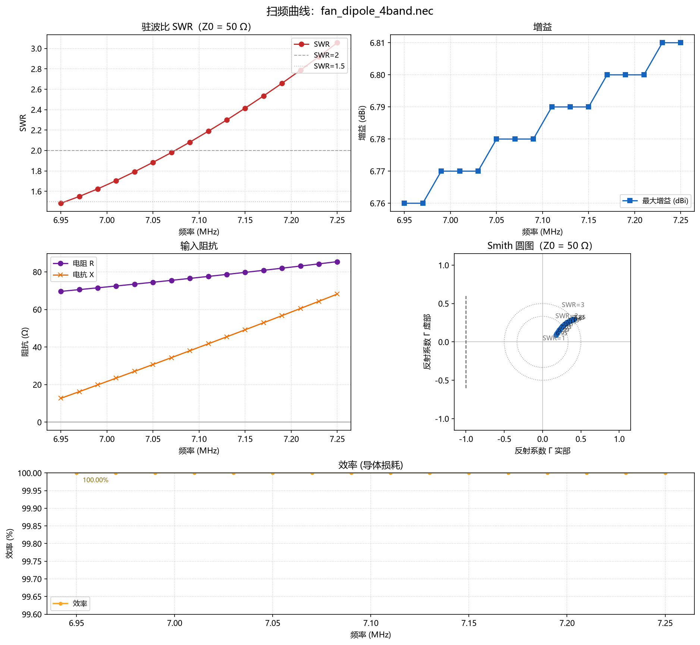
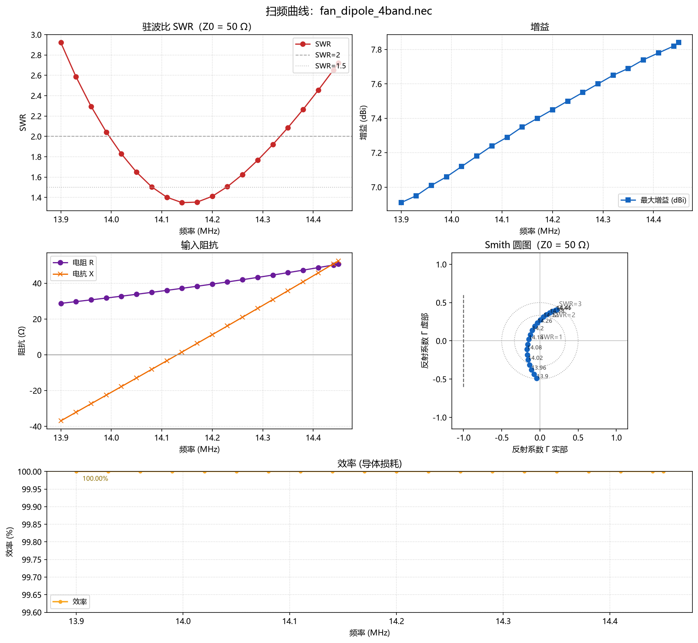
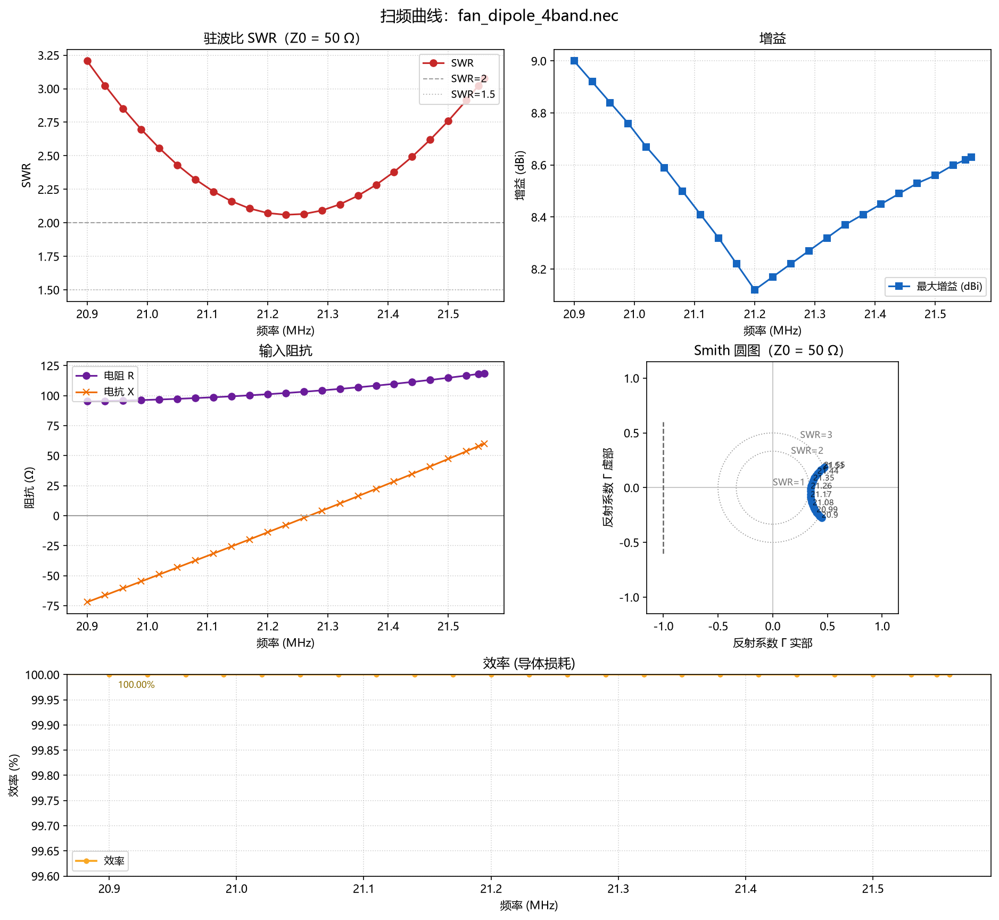
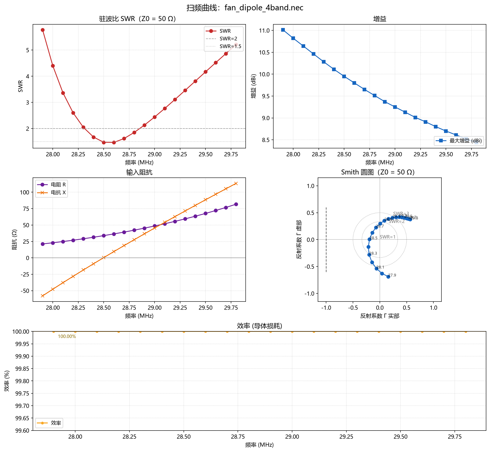
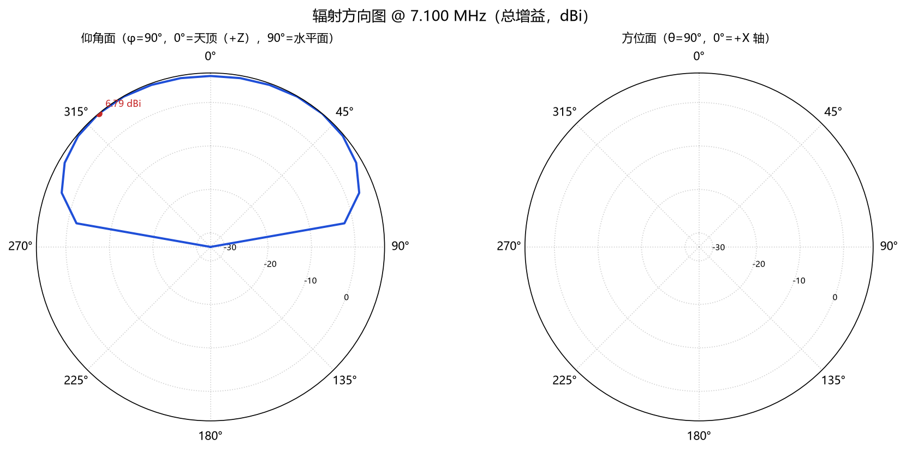
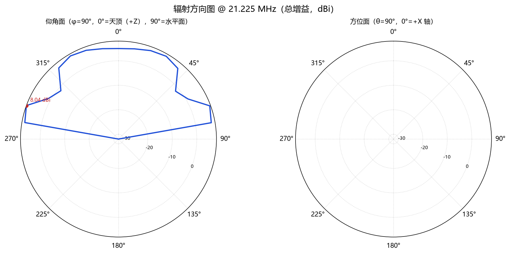
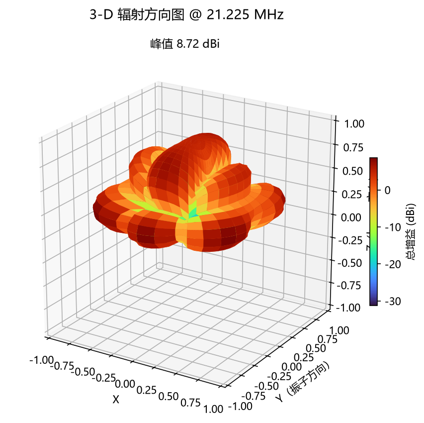

# 四波段扇形偶极 40/20/15/10 m（15 m 与 40 m 共用振子，三次谐波）

参照 BU-50A（Diamond 1:1 巴伦）+ 屋顶扇形偶极的经典架设方式设计：
**三个偶极振子并联在同一个馈电点**，其中不单独架设 15 m 振子——
15 m 直接利用 40 m 振子的三次谐波（7.1 × 3 = 21.3 MHz）工作。

仿真假设：馈点离地 12 m、平均地面（εr=13, σ=0.005）、导线直径 1.6 mm、
GN 2 Sommerfeld 地面、自由空间波长系数由坐标搜索调优得到。

## 1. 制作尺寸（导线总长）

| 振子 | 总长 | 每臂 | 形状（俯视） |
|---|---|---|---|
| 40 m（兼 15 m） | **21.00 m** | 10.50 m | 水平直线 |
| 20 m | **10.74 m** | 5.37 m | 端部横向展开 +0.75 m |
| 10 m | **5.28 m** | 2.64 m | 端部横向展开 −0.75 m |

- 三个振子的臂在同一水平面内从巴伦端子散开（扇形），远端横向间距 ≥1.5 m；
- **现场施工每臂先放长 20–30 cm**，按 40 m → 20 m → 10 m 的顺序逐根修剪
  （每剪一根都会轻微影响其他振子，顺序从低到高影响最小）；
- 绝缘导线（PVC 外皮）速度系数约 0.95–0.98，实物谐振会偏低，务必"先长后剪"。

## 2. 仿真结果（12 m 高度、平均地面、Z0=50 Ω）

| 波段 | 频点 SWR | 最佳 SWR | SWR<2 范围 | 峰值增益 |
|---|---|---|---|---|
| 40 m | 7.0→1.66 · 7.1→2.13 · 7.2→2.72 | 1.48 @ 6.95 | 6.95–7.07 MHz | 6.8 dBi |
| 20 m | 14.0→1.97 · 14.175→1.36 · 14.35→2.09 | 1.35 @ 14.14 | 14.02–14.32 MHz | 7.4 dBi |
| 15 m（三次谐波） | 21.0→2.65 · 21.225→2.06 · 21.45→2.53 | 2.06 @ 21.23 | 全段 2.0–2.7 | 8.2 dBi |
| 10 m | 28.0→4.40 · 28.5→1.48 · 29.0→2.44 · 29.7→4.87 | 1.47 @ 28.6 | 28.4–28.8 MHz | 9.8 dBi |






## 3. 方向图

7.1 MHz 是常规偶极方向图（12 m ≈ 0.28λ，主瓣高仰角、偏 NVIS）；
21.225 MHz 时 40 m 振子电气长度为 3λ/2，**方向图分裂成多瓣**
（6 瓣，峰值 8.7 dBi），主辐射方向不再垂直于振子——这是谐波共用的固有代价，
对 DX 反而有利（低仰角瓣更多）。





## 4. 已知限制（如实说明）

1. **15 m SWR ≈ 2.0–2.7 是固有的**：3λ/2 偶极中心馈电阻抗约 100 Ω，
   靠长度折中压到 2 左右；电台内天调或馈线损耗下完全可用。
2. **10 m 波段太宽**（28.0–29.7 MHz，6%），单根偶极 SWR<2 只能覆盖约 400 kHz
   （28.4–28.8）。常用频段（28.0–28.5 SSB/CW 低端）如需更好可微调缩短该振子。
3. **40 m 高频端**（7.1–7.2）SWR 2.1–2.7，CW 段（7.0–7.05）最好。
4. 馈点高度变化会整体平移谐振点：每降低 1 m，40 m 谐振约下移 30–50 kHz。
5. 效率按理想导体 + Sommerfeld 地面计算；实测 SWR 曲线形状会基本一致、数值略有偏移。

## 5. 复现

```powershell
# 阻抗/增益（按波段改频率）
python scripts/check-tools.py --call nec_run --arg path=designs/fan_dipole_4band/fan_dipole_4band.nec --arg freq_mhz=7.1
# 扫频曲线（40m 示例）
python scripts/check-tools.py --call nec_sweep --arg path=designs/fan_dipole_4band/fan_dipole_4band.nec --arg start_mhz=6.95 --arg stop_mhz=7.25 --arg step_mhz=0.02
```

## 6. 文件

| 文件 | 说明 |
|---|---|
| `fan_dipole_4band.nec` | NEC-2 模型（7 根线：1 巴伦短接线 + 3×2 振子臂） |
| `figures/` | 4 张扫频面板 + 2 张 polar + 1 张 3-D 方向图 |
