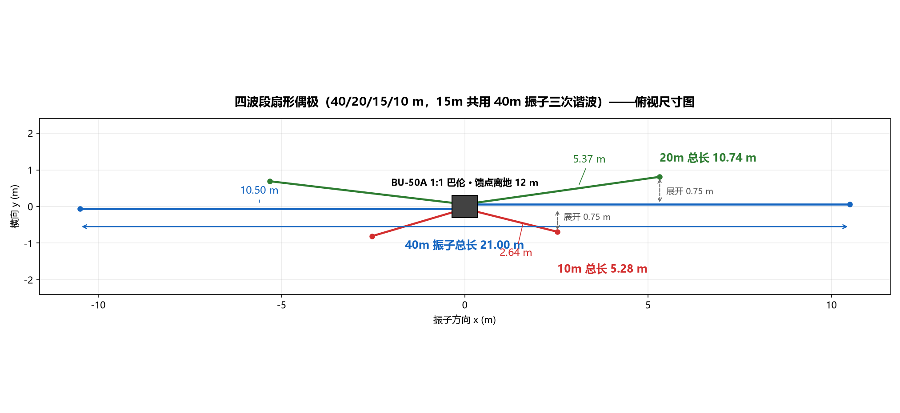

# 四波段扇形偶极天线设计报告（40 / 20 / 15 / 10 m）

> 设计日期：2026-10-29 · 工具：4nec2-mcp-server（NEC-2 / NEC2MP 引擎）
> 模型文件：[`fan_dipole_4band.nec`](fan_dipole_4band.nec) · 全部图件：[`figures/`](figures/)

## 1. 设计需求与方案

| 项目 | 内容 |
|---|---|
| 波段 | 40 m（7.0–7.2）、20 m（14.0–14.35）、15 m（21.0–21.45）、10 m（28.0–29.7 MHz） |
| 拓扑 | 扇形偶极（fan dipole）：3 个偶极振子**并联在同一馈电点**，经 1:1 巴伦（BU-50A）接单根 50 Ω 馈线 |
| 15 m 实现 | **不单独架振子**：利用 40 m 振子的三次谐波（7.1 × 3 = 21.3 MHz）覆盖 15 m |
| 架设条件（仿真假设） | 馈点离地 12 m、平均地面（εr=13, σ=0.005 S/m）、导线直径 1.6 mm |

工作原理：任一频率下，接近谐振的那副振子呈低阻抗并吸收几乎全部馈电功率，
其余振子呈高阻抗（处于失谐/偶次谐波电流节点）自动"隐身"。
40 m 振子在 21 MHz 为 3λ/2 电气长度，中心馈电阻抗约 100 Ω，可正常工作。

## 2. 外形尺寸



| 振子 | 导线总长 | 每臂长度 | 端部横向展开 | 臂数×段数 |
|---|---|---|---|---|
| 40 m（兼 15 m） | **21.00 m** | 10.50 m | 0（水平直线） | 2×42 段 |
| 20 m | **10.74 m** | 5.37 m | +0.75 m | 2×21 段 |
| 10 m | **5.28 m** | 2.64 m | −0.75 m | 2×11 段 |

巴伦端子间距按 12 cm 建模（模型中为一段 0.12 m 短接线，激励加在其中央段）。

**端点坐标（以巴伦中心为原点，x=振子方向，y=横向，单位 m）**：

| 振子臂 | 起点（巴伦端子） | 终点 |
|---|---|---|
| 40m 右臂 | (0, +0.06) | (+10.499, +0.06) |
| 40m 左臂 | (0, −0.06) | (−10.499, −0.06) |
| 20m 右臂 | (0, +0.06) | (+5.319, +0.81) |
| 20m 左臂 | (0, −0.06) | (−5.319, +0.69) |
| 10m 右臂 | (0, +0.06) | (+2.530, −0.69) |
| 10m 左臂 | (0, −0.06) | (−2.530, −0.81) |

**施工余量**：每臂先放长 20–30 cm，按 **40 m → 20 m → 10 m** 顺序逐根修剪
（低频振子先调，调它时对高频影响最小）。绝缘导线速度系数 0.95–0.98，
实物谐振会比仿真低 2–5%，必须"先长后剪"。

## 3. 仿真模型（NEC-2）

```
CM 4-band fan dipole 40/20/15/10m - 15m shares the 40m element (3rd harmonic)
CE feedpoint 12m AGL, BU-50A 1:1 balun, avg ground, wire 1.6mm dia
GW 1 3 0 -0.06 12.0 0 0.06 12.0 0.0008
GW 2 42 0 0.060 12.0 10.4990 0.060 12.0 0.0008
GW 3 42 0 -0.060 12.0 -10.4990 -0.060 12.0 0.0008
GW 4 21 0 0.060 12.0 5.3193 0.810 12.0 0.0008
GW 5 21 0 -0.060 12.0 -5.3193 0.690 12.0 0.0008
GW 6 11 0 0.060 12.0 2.5304 -0.690 12.0 0.0008
GW 7 11 0 -0.060 12.0 -2.5304 -0.810 12.0 0.0008
GE 0
GN 2 0 0 0 13 0.005
EX 0 1 2 0 1 0
FR 0 0 0 0 7.1 0
RP 0 19 37 1000 90 0 -10 10
EN
```

GW 1 是巴伦端子短接线（EX 0 1 2 把电压源加在它的中间段）；
GN 2 = Sommerfeld 平均地面；RP 覆盖仰角 −10°…80°。
换频率只需改 FR 卡（7.1 / 14.175 / 21.225 / 28.5）。

## 4. 仿真结果

### 4.1 SWR 汇总表（Z0 = 50 Ω）

| 波段 | 低端 | 中心 | 高端 | 最佳点 | SWR<2 范围 |
|---|---|---|---|---|---|
| 40 m | 7.0 MHz → **1.66** | 7.1 → 2.13 | 7.2 → 2.72 | 1.48 @ 6.95 | 6.95–7.07 MHz |
| 20 m | 14.0 → 1.97 | 14.175 → **1.36** | 14.35 → 2.09 | 1.35 @ 14.14 | 14.02–14.32 MHz |
| 15 m | 21.0 → 2.65 | 21.225 → **2.06** | 21.45 → 2.53 | 2.06 @ 21.23 | —（全段 2.0–2.7） |
| 10 m | 28.0 → 4.40 | 28.5 → **1.48** | 29.7 → 4.87 | 1.47 @ 28.6 | 28.4–28.8 MHz |

中心频点阻抗：7.1 MHz ≈ 72+16j Ω · 14.175 ≈ 37+2j Ω · 21.225 ≈ 102−8j Ω · 28.5 ≈ 36+10j Ω。

### 4.2 扫频曲线（SWR / 增益 / 阻抗 / Smith 圆图）

**40 m 波段**


**20 m 波段**


**15 m 波段（40m 振子三次谐波）**


**10 m 波段**


### 4.3 方向图

7.1 MHz：常规偶极方向图；12 m 仅 0.28λ，主瓣仰角高（偏 NVIS，省内通联有利）。


21.225 MHz：40 m 振子为 3λ/2，**方向图分裂为 6 瓣**，主瓣不再垂直于振子，
但低仰角分量增多，对 DX 有利；峰值增益 8.7 dBi（高于基波的 6.8 dBi）。


各波段峰值增益（含地面反射）：40 m 6.8 dBi · 20 m 7.4 dBi · 15 m 8.2 dBi · 10 m 9.8 dBi。

## 5. 如实说明（限制）

1. **15 m 的 SWR≈2.0–2.7 是固有代价**：3λ/2 偶极中心阻抗约 100 Ω，
   长度折中后无法更低；发射驻波容忍度内可用，介意则加天调。
2. **10 m 波段太宽**（6%），单振子 SWR<2 仅约 400 kHz（28.4–28.8 MHz）；
   主用 28.0–28.5 可把 10 m 振子剪短约 8 cm 整体下移。
3. **40 m 高频端**（7.1–7.2）SWR 2.1–2.7，CW 段（7.0–7.05）最佳；
   0.28λ 高度下馈电阻抗 70–85 Ω，SWR 最低只能到 1.4 左右。
4. 馈点每降低 1 m，40 m 谐振约下移 30–50 kHz（需按实测修剪）。
5. 效率按理想导体 + Sommerfeld 地面；实架环境（屋顶、树木、金属物）会改变数值，
   以网络分析仪实测修剪为准。

## 6. 施工要点

- 巴伦 BU-50A（1:1，带共模扼流）直接挂在 12 m 桅杆顶，50 Ω 馈线下引；
- 三对振子臂从巴伦两个端子螺钉散开，远端用绝缘撑杆/绳拉开横向间距（≥1.5 m）；
- 端部绝缘子 + 尼龙绳固定，预留修剪环；
- 调谐：先 40 m（用 7.05 MHz 瞄准，兼顾 21.2 MHz 复核）→ 20 m（14.175）→ 10 m（28.5）。

## 7. 文件清单

| 文件 | 说明 |
|---|---|
| [fan_dipole_4band.nec](fan_dipole_4band.nec) | NEC-2 模型（可直接在 4NEC2 GUI 打开） |
| [figures/fan_dipole_4band_topview.png](figures/fan_dipole_4band_topview.png) | 俯视尺寸图 |
| [figures/fan_dipole_4band_40m_sweep.png](figures/fan_dipole_4band_40m_sweep.png) | 40 m 扫频面板 |
| [figures/fan_dipole_4band_20m_sweep.png](figures/fan_dipole_4band_20m_sweep.png) | 20 m 扫频面板 |
| [figures/fan_dipole_4band_15m_sweep.png](figures/fan_dipole_4band_15m_sweep.png) | 15 m 扫频面板 |
| [figures/fan_dipole_4band_10m_sweep.png](figures/fan_dipole_4band_10m_sweep.png) | 10 m 扫频面板 |
| [figures/fan_dipole_4band_7.100MHz_polar.png](figures/fan_dipole_4band_7.100MHz_polar.png) | 40 m 方向图 |
| [figures/fan_dipole_4band_21.225MHz_polar.png](figures/fan_dipole_4band_21.225MHz_polar.png) | 15 m 方向图（极坐标） |
| [figures/fan_dipole_4band_21.225MHz_3d.png](figures/fan_dipole_4band_21.225MHz_3d.png) | 15 m 三维方向图（6 瓣） |

## 8. 复现命令

```powershell
python scripts/check-tools.py --call nec_run   --arg path=designs/fan_dipole_4band/fan_dipole_4band.nec --arg freq_mhz=7.1
python scripts/check-tools.py --call nec_sweep --arg path=designs/fan_dipole_4band/fan_dipole_4band.nec --arg start_mhz=6.95 --arg stop_mhz=7.25 --arg step_mhz=0.02
```
