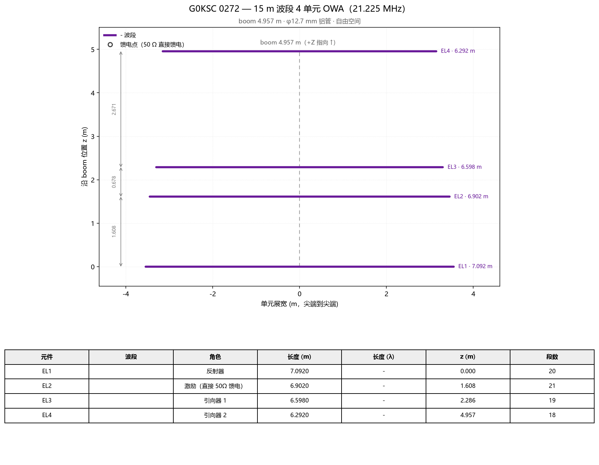
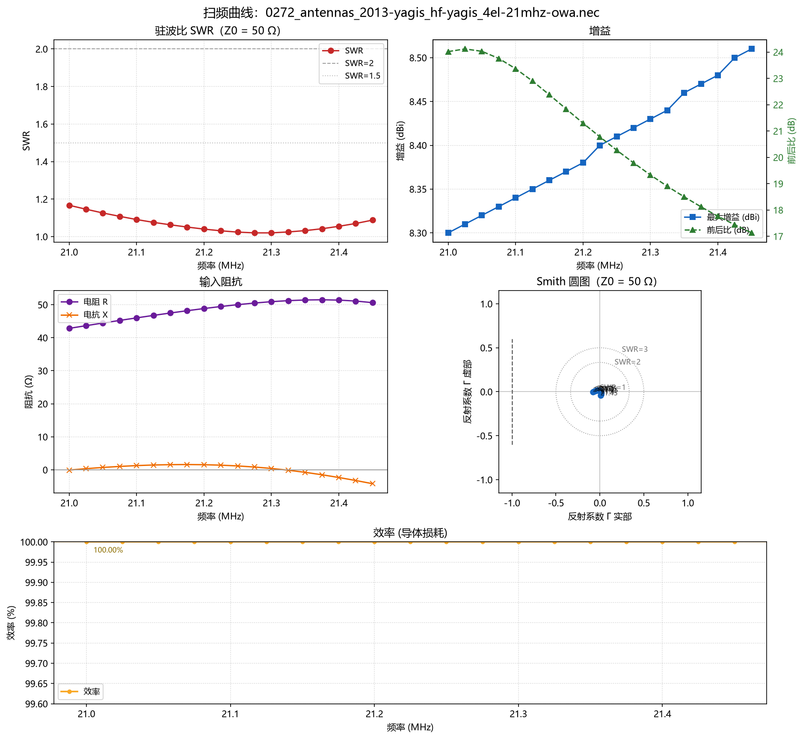
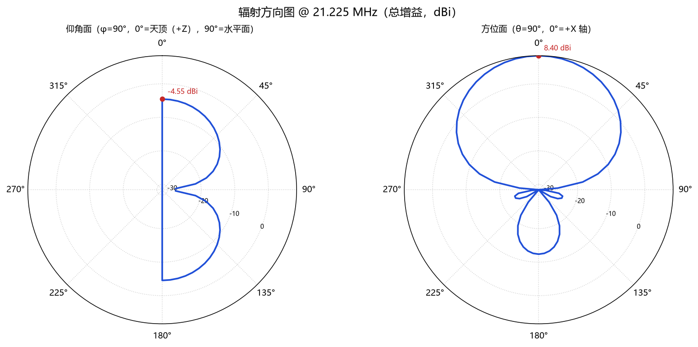
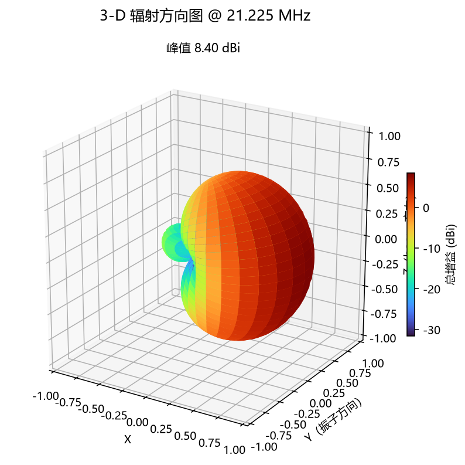

# G0KSC 0272 — 15 m 波段 4 单元 OWA（21.225 MHz）仿真复现

从 [模型目录](../../docs/模型目录.md) 中挑选的 G0KSC 参考模型
（`C:\4nec2\G0KSC\models\antennas\0272_antennas_2013-yagis_hf-yagis_4el-21mhz-owa.nec`），
用本项目的 MCP 工具链完成仿真验证与出图。这也是「先查参考模型库」工作流的第一次完整演示。

> ⚠️ 挑选时发现该库 372 个模型**全部缺少 CE 卡、几何行超 80 列**（NEC-2 卡片上限），
> 直接用引擎跑会分别报 `INCORRECT LABEL FOR A COMMENT CARD` 和 `GEOMETRY DATA CARD ERROR`。
> 已在 `nec2core.engine.sanitize_deck` 中自动修复（补 CE + 紧凑重写超长数据卡），
> 并加了回归测试（`tests/test_engine.py`）。另外该库部分模型尺寸与频率不自洽
> （如名为 14/21 MHz 实为 2 m 波段尺寸），本模型的振子全长 6.3–7.1 m ≈ 0.45–0.50 λ，
> 几何自洽，可放心复现。

## 模型

| 项 | 值 |
|---|---|
| 类型 | 4 单元 OWA（Optimized Wideband Antenna），振子沿 Y、boom 沿 +X |
| 设计频率 | 21.225 MHz（15 m 波段） |
| boom | 4.957 m（0.35 λ） |
| 振子 | 反射器 7.092 m / 激励 6.902 m / 引向 6.598 m / 引向 6.292 m |
| 管径 | φ12.7 mm（1/2 英寸铝管） |
| 馈电 | 激励振子中心直接 50 Ω（OWA 的特点：无需匹配网络） |



## 仿真结果（自由空间，nec2dxs11k）

| 指标 | 值 |
|---|---|
| 输入阻抗 @21.225 | **49.46 + j1.42 Ω** |
| SWR @21.225 | **1.031**（回波损耗 36.3 dB） |
| 最大增益 | **8.40 dBi**（水平极化，主瓣朝 +X） |
| 前后比 | **20.8 dB** |
| SWR<2 带宽 | **覆盖整个 21.0–21.45 MHz**（最优 1.02 @ 21.275 MHz） |
| 效率（导体损耗） | 100%（模型未加 LD 损耗卡） |







## 文件清单

| 文件 | 说明 |
|---|---|
| `0272_15m_owa.nec` | 原始卡片组（复制自 G0KSC 库） |
| `0272_15m_owa_21.225MHz.out` | NEC-2 引擎完整输出（`nec_run` 保存） |
| `geometry.png` | 单元布局与尺寸图（`nec2core.plots.geometry_schematic`） |
| `..._sweep.png` | 21.0–21.45 MHz 扫频仪表盘（SWR/增益+前后比/阻抗/Smith + 效率） |
| `..._21.225MHz_polar.png` | 仰角面 + 方位面极坐标方向图 |
| `..._21.225MHz_3d.png` | 3-D 增益球面图 |

## 复现

```powershell
# 引擎输出 + 指标
mcp nec_run --arg path=C:\4nec2\G0KSC\models\antennas\0272_antennas_2013-yagis_hf-yagis_4el-21mhz-owa.nec --arg save_out_path=designs\g0ksc_0272_15m_owa\0272_15m_owa_21.225MHz.out
# 扫频图
mcp nec_plot_sweep --arg path=...0272...nec --arg start_mhz=21.0 --arg stop_mhz=21.45 --arg step_mhz=0.025 --arg out_dir=designs\g0ksc_0272_15m_owa
# 方向图（含 3D）
mcp nec_plot_pattern --arg path=...0272...nec --arg include_3d=true --arg out_dir=designs\g0ksc_0272_15m_owa
```
