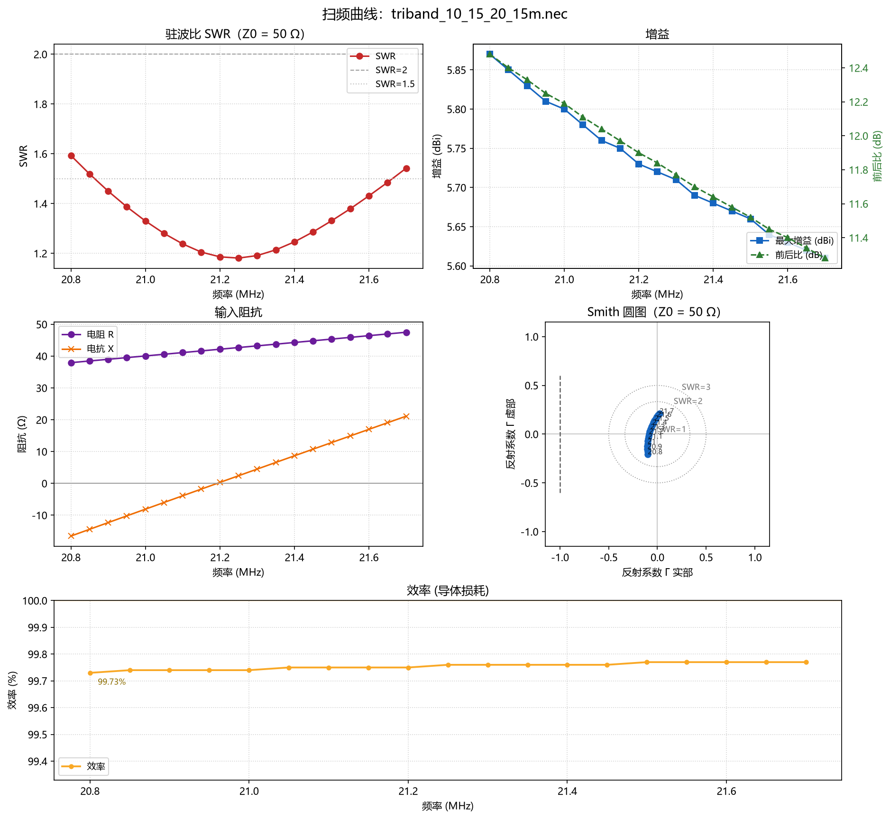
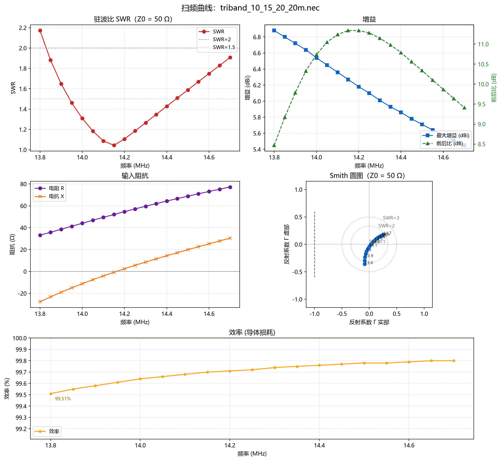
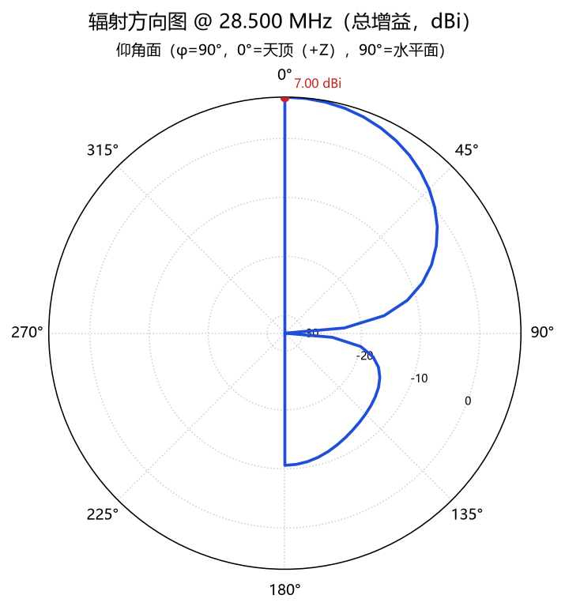
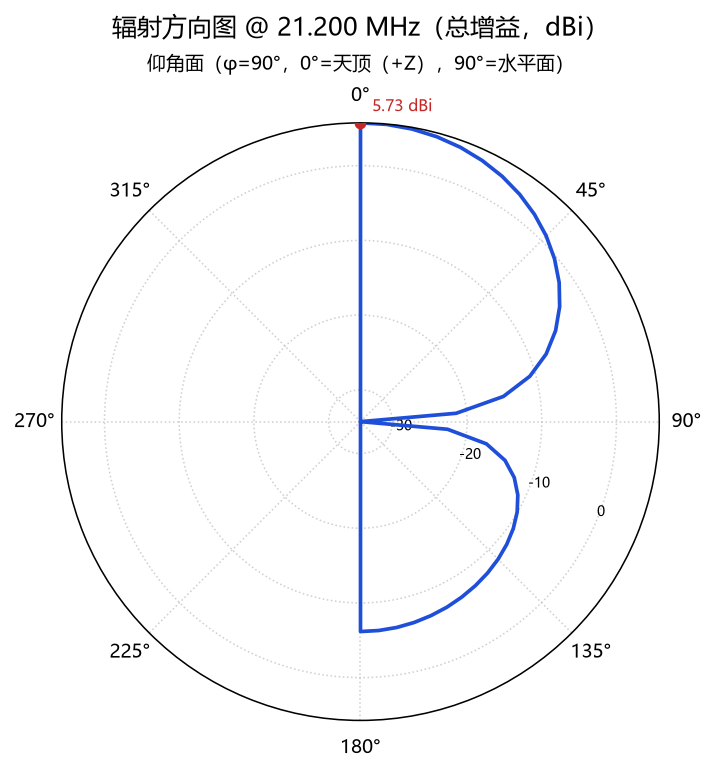
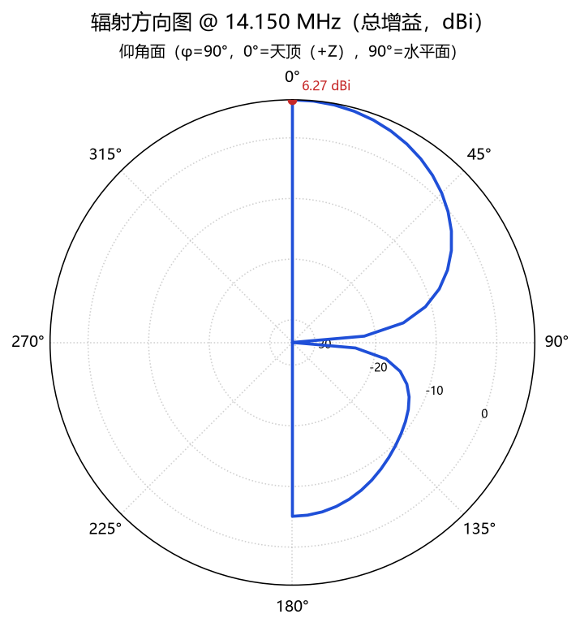
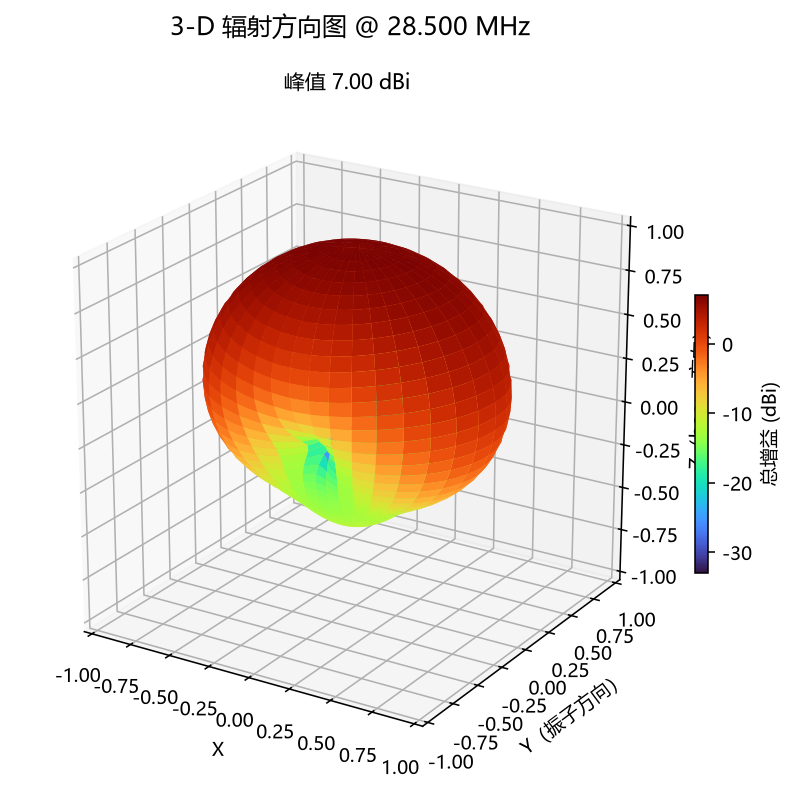
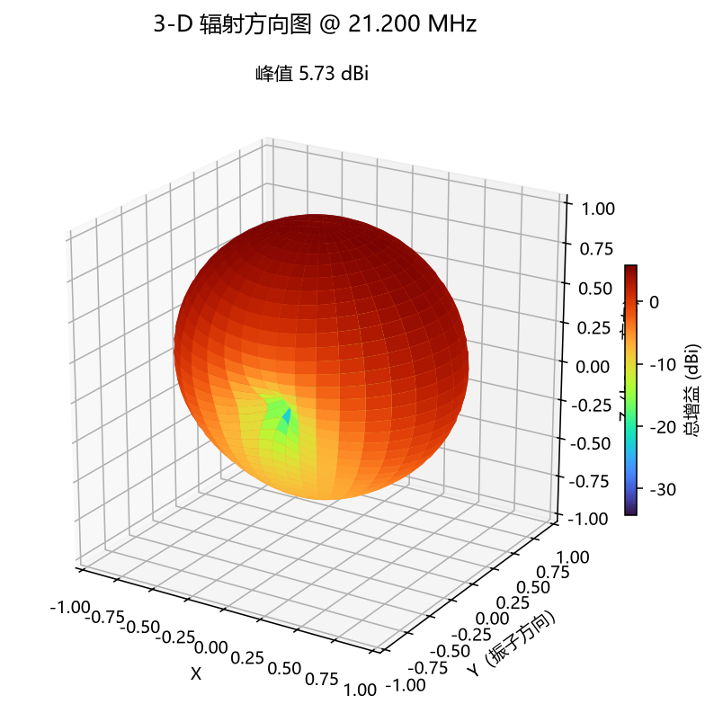
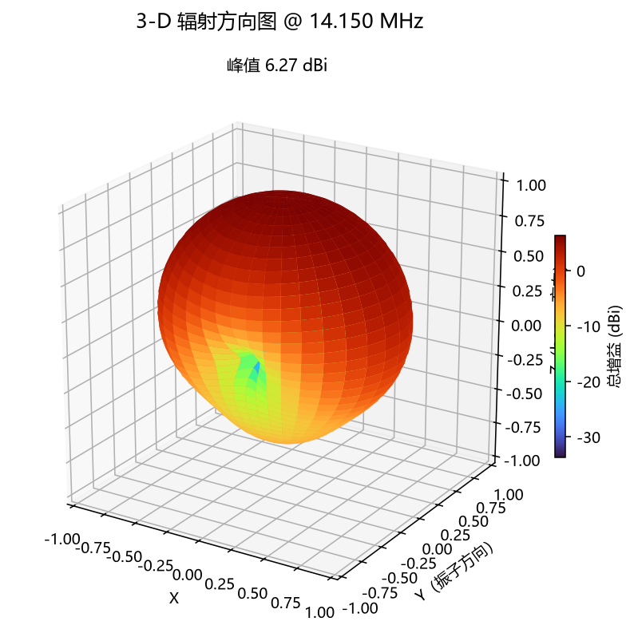
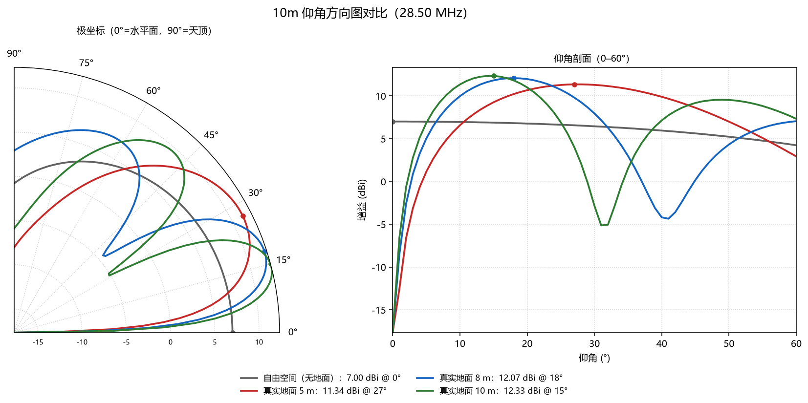

# 成果展示：10 / 15 / 20 m 三波段单 boom 八木

一套用 NEC-2 优化出来的**单 boom 嵌套三波段八木**：10 m 波段 3 单元、15 m 与 20 m 各 2 单元，
每个波段的驱动单元中心各自直接 50 Ω 馈电（三路馈线 + 天线开关，**不是**三个激励振子并联到一个巴伦），boom 总长 7.80 m，三份波段 deck 全部在本项目的 MCP 工具里跑通。

工程细节、优化过程与已知限制见 [设计文档](../designs/triband_10_15_20/README.md)；
本文只放结果与图，方便快速判断这套天线值不值得做。

---

## 1. 关键指标

| 波段 | 覆盖 | 中心 SWR | 增益 | 前后比 | 效率 | 带内最差 SWR |
| --- | --- | --- | --- | --- | --- | --- |
| 10 m | 28.0–29.7 MHz | **1.256** @ 28.51 MHz | **7.00 dBi** | 17.6 dB | 99.82 % | 1.79（28.0 / 29.7 MHz） |
| 15 m | 21.0–21.45 MHz | **1.192** @ 21.18 MHz | 5.74 dBi | 11.9 dB | 99.75 % | 1.33（21.0 MHz） |
| 20 m | 14.0–14.35 MHz | **1.042** @ 14.14 MHz | 6.29 dBi | 11.3 dB | 99.69 % | 1.35（14.35 MHz） |

* 三个波段带内 SWR 全部 < 2，**每个波段独立馈电、不需要任何匹配网络**（三路 50 Ω + 三选一天线开关；并联到同一个巴伦时 10 m/20 m 会失配到 SWR 7–11，原因与实测见 [design README §3](../designs/triband_10_15_20/README.md)）。
* 效率 99.7 %–99.8 %（20 mm 铝管，σ = 3.54×10⁷ S/m），损耗几乎全部来自导体，实际系统里地面和接头才是主项。
* 主瓣都指向 boom 正前方（θ = 0°，+Z），后瓣在 θ = 180°。

## 2. 几何


| 元件 | 波段 | 角色 | 长度 (m) | 长度 (λ) | boom 位置 z (m) | 段数 |
| --- | --- | --- | --- | --- | --- | --- |
| 20R | 20 m | 反射器 | 10.6171 | 0.501 | 0.000 | 41 |
| 15R | 15 m | 反射器 | 7.4490 | 0.526 | 1.100 | 31 |
| 10R | 10 m | 反射器 | 5.2630 | 0.500 | 2.600 | 21 |
| 20D | 20 m | 驱动 | 9.8789 | 0.466 | 3.300 | 41 |
| 15D | 15 m | 驱动 | 6.6603 | 0.471 | 4.100 | 31 |
| 10D | 10 m | 驱动 | 4.8630 | 0.462 | 5.600 | 21 |
| 10Dir | 10 m | 引向 | 4.3157 | 0.410 | 7.800 | 19 |

* 单元全部垂直于 boom（Y 方向），boom 沿 +Z；boom 总长 **7.80 m**，最长单元 10.62 m，最小间距 0.70 m。
* 馈电点 = 各驱动的**中心段**（10D 段 11、15D 段 16、20D 段 21），`EX 0 <tag> <段号> 0 1 0 0` 直接 50 Ω。
* 单 boom 三波段嵌套的代价：10 m 的引向器缩到 0.410λ（教科书写法 0.42–0.44λ），换来 28.0–29.7 MHz 全段 SWR < 2。

## 3. 驻波 / 增益 / 阻抗 / 效率

10 m（27.8–30.1 MHz，24 点）：


15 m（20.8–21.7 MHz，19 点）：



20 m（13.8–14.7 MHz，19 点）：



每张图都是同一套六联面板：SWR（含 SWR = 1.5 / 2 参考线）、最大增益 + 前后比、输入阻抗 R/X、
Smith 圆图（SWR = 1/2/3 圆 + Γ 轨迹 + 频点注记）、底部「效率（导体损耗）」。

## 4. 辐射方向图

仰角面（E 面，φ = 90°，0° = 沿 +Z 即 boom 正前方）：

| 10 m @ 28.50 MHz | 15 m @ 21.20 MHz | 20 m @ 14.15 MHz |
| --- | --- | --- |
|  |  |  |

3-D 波瓣（球面 37 × 73 网格，5° 步进，按真实 dBi 着色）：

| 10 m | 15 m | 20 m |
| --- | --- | --- |
|  |  |  |

> ⚠️ 对 boom 沿 +Z 的八木，`nec_plot_pattern` 的 `plane="azimuth"`（固定 θ = 90°）得到的是**垂直 boom 的平面**，
> 只有 −0.8 dBi，别当成"方位图"。看主瓣请用 `plane="elevation"` 或 3-D。

## 5. 架设高度与真实地面

把天线转成水平姿态（boom 沿 +X、振子沿 Y、导线全部在 `z = H`），地面 `GN 2 0 0 0 13.0 0.005`
（εr = 13、σ = 0.005 S/m），与自由空间对比，取 1° 步进的仰角剖面：



| 波段 | 条件 | 峰值增益 | 起飞角 | 10° 仰角 | 20° 仰角 |
| --- | --- | --- | --- | --- | --- |
| 10 m | 自由空间 | 7.00 dBi | 0° | 6.94 | 6.76 |
| 10 m | 地面 5 m | 11.34 dBi | 27° | 6.56 | 10.66 |
| 10 m | 地面 8 m | 12.07 dBi | 18° | **9.96** | 11.96 |
| 10 m | 地面 10 m | **12.33 dBi** | 15° | 11.33 | 10.98 |
| 15 m | 自由空间 | 5.73 dBi | 0° | 5.70 | 5.60 |
| 15 m | 地面 5 m | 9.54 dBi | 36° | 2.94 | 7.65 |
| 15 m | 地面 8 m | 10.73 dBi | 24° | 6.79 | 10.46 |
| 15 m | 地面 10 m | **10.81 dBi** | 19° | 8.24 | 10.81 |
| 20 m | 自由空间 | 6.27 dBi | 0° | 6.22 | 6.06 |
| 20 m | 地面 5 m | 8.61 dBi | 44° | 0.53 | 5.55 |
| 20 m | 地面 8 m | 10.04 dBi | 33° | 3.97 | 8.54 |
| 20 m | 地面 10 m | **10.77 dBi** | 28° | 5.90 | 10.04 |

另两张（15 m / 20 m）：
[15 m](images/triband/triband_15m_elevation_vs_height.png) ·
[20 m](images/triband/triband_20m_elevation_vs_height.png)

结论：

* 架得越高 → 主瓣越低、峰值越高。10 m 波段 10 m 高时起飞角 15°、峰值 12.33 dBi（比自由空间高 5.3 dB，
  是地面镜像的同相叠加，不是天线本身变强）。
* **DX 取向**：10 m 波段至少架 8 m（10° 仰角 9.96 dBi）；15/20 m 在 5 m 高时 10° 仰角只有 0.5–2.9 dBi，
  被地面抵消得厉害，要 8–10 m 才顺。
* **NVIS / 近距离**：20 m 波段架 5 m 高时 44° 有 8.61 dBi，正好覆盖几百公里内。
* NEC 的 `GN 2` 是反射系数法，功率表里的"效率"仍接近 100 %，**不要**把它当成地面损耗。

## 6. 如果真要造

* 材料：20 mm（0.01 m 半径）铝管，boom 用 30 × 30 mm 方铝或 25 mm 铝管；单元与 boom 之间用绝缘夹块。
* 加工：10 m/15 m/20 m 三组单元分别定位在 z = 2.60 / 1.10 / 0 的反射器、3.30 / 4.10 / 5.60 的驱动、
  7.80 的引向器（表格里的数值是**尖端到尖端**长度，锯切按表给长度即可）。
* 馈电：三根 50 Ω 馈线分别接三个驱动单元中心 + 收发信机侧三选一天线开关（不需要伽玛匹配、不需要 balun 也能 < 2.0 SWR）；**不要**把三个驱动单元直接并联到同一个巴伦，
  收发机侧用一个三选一天线开关；不用的波段驱动单元用继电器断开（结构仍在、电气开路）。
* 需要更宽的 10 m 段（比如覆盖 29.7 MHz 以上）时，把 10Dir 再缩短 1–2 %，代价是中心增益再掉 0.1–0.2 dB。

## 7. 已知限制

1. 10 m 只有 3 单元 + 0.410λ 引向器，增益 7.0 dBi 低于纯 10 m 三段八木的 8.2 dBi —— 这是"单 boom 三波段"的必然折衷。
2. 15 m 与 20 m 各 2 单元，增益 5.7 / 6.3 dBi，前后比 11–12 dB，属于"能用"级别，不适合追求极致 F/B。
3. 三个波段中心频率固定（28.5 / 21.2 / 14.15 MHz）；想改频点需要整体重算单元长度（`--optimize` 可自动搜）。
4. 未包含陷波器（traps）、未考虑雨雪与介质覆盖层，也未做功率耐受与机械强度分析。
5. 地面研究中 `GN 2` 只用一个平均地参数；实际场地差异会让起飞角和峰值再变化 1–2 dB。

## 8. 复现

```powershell
# 重新生成三份 deck、几何图与 design.json（需要本机装好 4NEC2）
.\.venv\Scripts\python.exe scripts\design_triband.py --report

# 想重新优化单元长度（每波段坐标搜索，几十秒）
.\.venv\Scripts\python.exe scripts\design_triband.py --optimize

# 地面/架高对比
.\.venv\Scripts\python.exe scripts\ground_study.py

# 直接出图（也可以让 AI 客户端调用 MCP 工具 nec_plot_pattern / nec_plot_sweep）
.\.venv\Scripts\python.exe scripts\check-tools.py --call nec_plot_sweep `
    --arg path=designs/triband_10_15_20/triband_10_15_20_10m.nec `
    --arg start_mhz=27.8 --arg stop_mhz=30.1 --arg step_mhz=0.1
```

产物：

| 文件 | 内容 |
| --- | --- |
| [`triband_10_15_20.nec`](../designs/triband_10_15_20/triband_10_15_20.nec) | master deck（10 m 馈电 + 球面 RP） |
| [`triband_10_15_20_10m.nec`](../designs/triband_10_15_20/triband_10_15_20_10m.nec) | 10 m 工作，15/20 m 驱动开路 |
| [`triband_10_15_20_15m.nec`](../designs/triband_10_15_20/triband_10_15_20_15m.nec) | 15 m 工作 |
| [`triband_10_15_20_20m.nec`](../designs/triband_10_15_20/triband_10_15_20_20m.nec) | 20 m 工作 |
| [`design.json`](../designs/triband_10_15_20/design.json) | 三波段完整扫描数据 + 几何 |
| [`ground_patterns.json`](../designs/triband_10_15_20/ground_patterns.json) | 自由空间 / 5 / 8 / 10 m 仰角剖面 |

> 引擎：`C:\4nec2\exe\nec2dxs11k.exe`（NEC-2，双精度）。所有数字都可以用上面的命令逐条复算。
